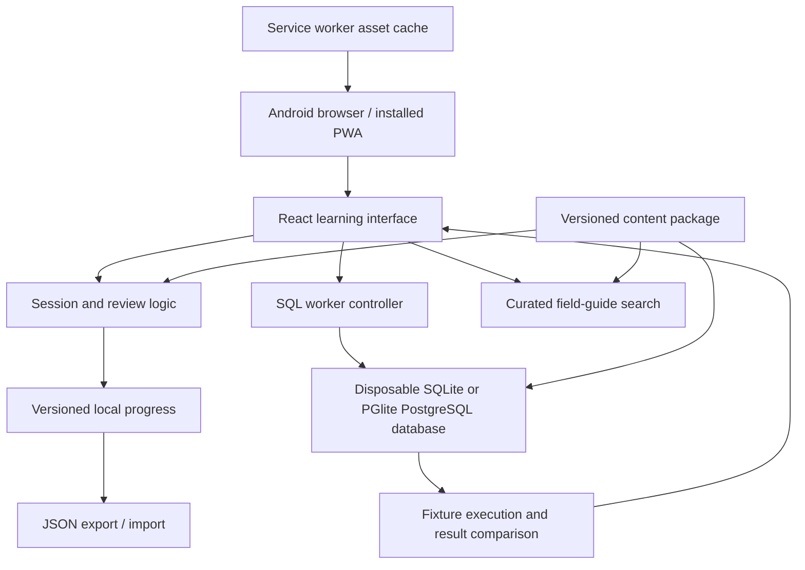
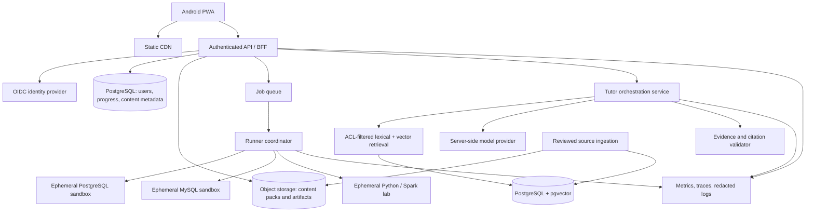

# System design and architecture

Design date: 5 November 2026. This is the implementation blueprint and expansion plan. **The initial app is a browser-local learning release with SQLite and PostgreSQL through PGlite. Cloud services, remote database runners, and generative RAG below remain planned integrations.** Consult the README and QA report for verified implementation details, supported challenge coverage, and exact inventory.

## Architectural decisions

| Decision | Rationale | Tradeoff |
| --- | --- | --- |
| React + TypeScript responsive PWA | One interface for Android, desktop, keyboard, and touch; installable through a supporting browser. | Browser storage can be cleared; native Android integrations are limited. |
| SQLite through sql.js and PostgreSQL through PGlite in disposable Web Workers | Actual engine execution in the browser without learner database credentials; PostgreSQL syntax is evaluated by a PostgreSQL build. | Browser memory and startup costs differ; PGlite is not a remote multi-user PostgreSQL server or a cloud warehouse. |
| Deterministic grading before coaching | Correctness comes from execution on fixtures and explicit comparison rules. | Fixture coverage is finite; no test suite proves arbitrary SQL equivalence. |
| Versioned, reviewed content packages | Reproducible feedback, provenance, offline use, and safe expansion. | Requires ongoing editorial work. |
| Local progress with export/import first | Useful immediately without account or backend setup. | No automatic cross-device sync or tamper-resistant competitive scores. |
| Searchable curated guide first | Grounded reference material works offline without API keys. | Keyword retrieval is not a conversational or generative RAG system. |
| Separate future application database and execution sandboxes | Learner queries must never run against user/account data. | More operational components when native engines are introduced. |

The content registry uses 20 stable track IDs: `sql`, `python`, `modeling`, `ingestion`, `orchestration`, `quality`, `spark`, `streaming`, `lakehouse`, `cloud`, `reliability`, `architecture`, `git`, `linux`, `apis`, `formats`, `warehouse`, `governance`, `observability`, and `mlops`. Skills form a prerequisite graph within and across these tracks. Track completion and skill mastery are separate derived values; neither is manually fabricated to make a dashboard look populated. See the phased prerequisite map in [RESEARCH.md](RESEARCH.md).

sql.js provides browser SQLite and a worker option for CPU-intensive queries. [sql.js documentation](https://github.com/sql-js/sql.js) PGlite provides an in-process PostgreSQL build for browser use; an in-memory instance supports disposable practice datasets. [PGlite getting started](https://pglite.dev/docs/) This application uses its own disposable worker lifecycle rather than a persistent shared multi-tab database. Service workers can cache application resources, but offline behavior depends on explicit caching and browser lifecycle behavior. [MDN offline PWA guidance](https://developer.mozilla.org/en-US/docs/Web/Progressive_web_apps/Guides/Offline_and_background_operation)

## Initial release boundary



The browser owns progress in this release. A private hosting gate, if used, restricts visits but does not create cloud synchronization. An offline copy is readable by the device user; this is appropriate for personal practice, not exam secrecy. Hidden browser fixtures are pedagogically hidden, not cryptographically secret. The UI must not advertise competitive integrity from client-only grades.

Local storage schema should include a schema version, content version, attempt IDs, timestamps, skill IDs, completion evidence, due reviews, preferences, and drafts. Validate imports before replacing any state; reject oversized or malformed input; preserve a backup. Migration failure should preserve the original data and offer export. Show an explicit save failure if quota or privacy mode prevents persistence.

Offline cache policy: precache the shell, icons/fonts, content, worker, and WASM needed for core practice; version caches by build; remove obsolete caches after successful activation; preserve learner progress separately. A fresh browser needs an initial online load. Authenticated cloud responses and tutor transcripts should not enter a shared cache. Test a second launch in airplane-mode simulation; do not infer offline support from a manifest alone.

## SQL execution and grading

### Task contract

```ts
type SqlTask = {
  id: string;
  version: number;
  engine: "sqlite" | "postgres" | "mysql" | "duckdb";
  engineVersion: string;
  prompt: string;
  schema: string;
  fixtures: Array<{ id: string; setupSql: string; visibility: "sample" | "validation" }>;
  referenceSql: string;
  expectedColumns: string[];
  comparison: {
    rowOrder: "ordered" | "multiset";
    columnNames: "required" | "ignored";
    numericTolerance?: { absolute: number; relative: number };
  };
  hints: string[];
  explanation: string;
  sourceUrls: string[];
};
```

This is a target schema; source types may be simpler in the initial build. A task must state whether ordering and aliases matter. Validate reference queries on every fixture in CI. Test known incorrect solutions to ensure the fixtures distinguish common mistakes.

### Execution sequence

1. Validate input length and supported statement class. SQL parsing/engine authorization is the boundary; a keyword regex alone is not a secure SQL sandbox.
2. Create a fresh database for each fixture from trusted setup data. Learner SQL must not alter the next attempt's input.
3. Run the candidate and reference in separate clean instances, or reset the fixture between them. Restrict practice to a single read query unless a task explicitly provides a disposable DDL/DML sandbox.
4. Run inside a dedicated worker. Enforce a wall-time deadline in the parent and terminate/recreate the worker on timeout. Bound returned rows, cell sizes, SQL length, and fixture size. Do not silently truncate and then mark a partial result correct.
5. Canonicalize values according to task rules. Preserve NULL, duplicate multiplicities, column positions, and exact integer values. Never coerce NULL to zero or stringify every value into the same type. Use decimal-aware comparison for monetary tasks.
6. Compare ordered rows only when the task requires an order. Otherwise compare multisets, not sets: duplicate rows count. Ties require an explicit deterministic tie-breaker when a task expects exact order.
7. Return `correct`, `incorrect`, `syntax_error`, `timeout`, `unsupported`, or `internal_error`. An engine failure is not learner failure.
8. Return observable evidence: mismatched columns, row counts, missing/unexpected rows, first divergent ordered row, and the failing fixture's relevant edge case. A rule-based hint may suggest a likely cause but must not claim certainty beyond the evidence.
9. Persist the attempt only once using its unique ID. Reward a successful milestone once; retries and refreshes must not duplicate XP.

Useful fixtures include: no rows, one row, NULL join keys, unmatched dimension rows, duplicate keys, ties, zero/negative values, boundary timestamps, late updates, a deleted record, and many-to-many joins. Separate fixture coverage from semantic proof. A correct result on a finite fixture set can still be wrong on other data.

### Feedback model

```json
{
  "status": "incorrect",
  "engine": "sqlite",
  "taskVersion": 1,
  "checks": [{ "fixtureId": "unmatched-customers", "passed": false }],
  "evidence": {
    "expectedRowCount": 4,
    "actualRowCount": 3,
    "missingRows": [[7, 0]],
    "unexpectedRows": []
  },
  "diagnosis": {
    "confidence": "suggestion",
    "text": "A customer with no orders is missing. Check whether your join and filters preserve unmatched customers."
  }
}
```

Do not use text similarity to the reference answer as SQL correctness. Do not execute an AI-suggested repair automatically. Do not claim a query is inefficient without a plan, relevant data scale, and measurement on the named engine.

## Multi-engine expansion

The initial execution choices are SQLite via sql.js and PostgreSQL via PGlite, each inside a disposable browser worker. PGlite evaluates PostgreSQL SQL directly rather than translating it to SQLite. Pin the PGlite package and record its underlying PostgreSQL version; the documentation's `current` version is not proof of the bundled engine version. The in-browser engine does not reproduce server administration, replication, network behavior, multi-client concurrency, or all extension deployments. Test each task against both engines before advertising dual-engine support, including result type conversion and engine-specific syntax.

Add a genuine DuckDB browser worker for analytical/file exercises if the device budget permits. Add remote PostgreSQL and MySQL in isolated server runners for server-specific labs. Cloud-warehouse tasks should use actual controlled accounts and strict job/byte budgets, or remain explicitly labeled reference exercises. A dialect dropdown must never merely relabel another engine's execution.

### SQL language and depth choices

The reference library covers eight SQL families: SQLite, PostgreSQL, MySQL, DuckDB, BigQuery GoogleSQL, Snowflake SQL, SQL Server T-SQL, and Spark SQL. Language reference availability is distinct from runnable-engine availability. In the initial app, only SQLite and PGlite PostgreSQL should be presented as execution choices; the other six are reference paths until their runners are implemented and verified.

Each language path should support four depths: **Foundations** (types, SELECT, filtering, NULL, joins, grouping); **Intermediate** (CTEs, subqueries, windows, date/string functions, analytical patterns); **Advanced** (dialect-specific functions, nested data, mutation/incremental patterns, plans and optimization); **Professional** (transactions and isolation, operational constraints, migration, measured cost/performance, failure recovery). A difficulty filter chooses problem complexity; it must not imply that every language already has executable problems at every depth. Native-server topics need an appropriate server lab even when basic SQL runs in PGlite.

Each runner implements `prepareFixture`, `execute`, `explain`, `cancel`, and `destroy`; returns engine/version plus normalized typed results; and has its own golden tests. Pin engine images and fixture versions. Run a conformance suite covering NULL ordering, integer division, date arithmetic, timezone conversion, string comparison, boolean types, identifier quoting, and window frames. Native engines have real differences; avoid pretending one canonical SQL translation fully emulates them.

## Planned cloud architecture



The initial deployment does not need Kafka, Kubernetes, or Spark simply because it teaches them. Begin with one API service, one relational database, one durable queue, object storage, and isolated runner infrastructure. Introduce additional infrastructure only for demonstrated workload needs. A static Sites deployment can serve the PWA; a hosted edge API may call external HTTP services, while raw native SQL execution belongs in a separate controlled runner environment.

## Proposed persistent model

| Entity | Key fields / invariants |
| --- | --- |
| `users` | `id`, identity subject, locale, timezone, deletion state; no password storage if delegated to OIDC. |
| `skills` | `id`, title, prerequisite graph, track, version; reject prerequisite cycles. |
| `content_versions` | task ID/version, type, difficulty, objective, engine, immutable artifact hash, review status. |
| `attempts` | ID, user ID, task/version, engine/version, submitted time, verdict, hint usage, grader version; unique idempotency key per user. |
| `attempt_checks` | attempt ID, fixture ID, verdict, bounded evidence; no other learner's data. |
| `skill_progress` | user ID/skill ID, evidence counts, last success, due date, mastery estimate and algorithm version. |
| `review_events` | immutable reviews with due/answered time, result, interval, timezone. |
| `achievement_awards` | unique `(user_id, achievement_id, milestone_version)`; server computes eligibility. |
| `drafts` | user ID/task ID, query text, revision, updated time; conflict-aware sync. |
| `sources` | URL, title, publisher, version, license, retrieved/reviewed timestamps, content hash, visibility. |
| `chunks` | source ID, section, text, token count, embedding model/version, vector, access scope. |
| `tutor_turns` | user ID, task/version, prompt version, source IDs, model ID, answer, citation/evaluation status. |
| `lab_jobs` | user ID, engine/image digest, state, expiry, resource budget, result pointer; automatic cleanup. |

Keep account data, lab data, and learning analytics separated by access policy. Tenant and user IDs must come from the verified session, not arbitrary request fields. PostgreSQL row policies can add defense in depth; table owners and privileged roles require special attention because they can bypass ordinary row security. [PostgreSQL row security](https://www.postgresql.org/docs/current/ddl-rowsecurity.html)

## Planned API contracts

All routes require versioned schemas, request-size limits, consistent error codes, and correlation IDs. Authorization is checked per object. Server-generated grading/XP is authoritative for cloud profiles; a local offline import is unverified until replayed or otherwise validated.

| Endpoint | Behavior |
| --- | --- |
| `GET /v1/content?manifestVersion=...` | Return accessible content manifest with hashes and compatible app version. |
| `POST /v1/attempts` | Accept task/version, engine, query/answer, client attempt ID; return attempt ID and queued/completed state. Idempotency prevents duplicate reward. |
| `GET /v1/attempts/{id}` | Return only the authenticated owner's verdict and bounded feedback. |
| `POST /v1/labs` | Allocate a permitted engine with expiry and budget; never return infrastructure credentials. |
| `DELETE /v1/labs/{id}` | Cancel and destroy the owner's sandbox; safe to repeat. |
| `POST /v1/progress/sync` | Upload append-only events with cursor; deduplicate; return server cursor and conflicts. |
| `POST /v1/tutor/turns` | Accept question, task/version, optional attempt ID and hint level; return cited answer or evidence-insufficient response. |
| `GET /v1/export` | Produce authenticated account export with a short-lived download URL. |
| `DELETE /v1/account` | Start authenticated deletion workflow including derived vectors and stored artifacts. |

Example error envelope: `{ "error": { "code": "SQL_TIMEOUT", "message": "The query exceeded this lab's time limit.", "retryable": true }, "requestId": "..." }`. Return 401/403 for identity/access failures, 409 for content revision conflicts, 413 for oversized submissions, and 429 with retry guidance for limits. Do not disguise service outages as incorrect answers.

## RAG tutor design

### Stage zero: honest retrieval

A local field guide can rank reviewed articles with lexical matching, return matching excerpts, and link sources. This is useful retrieval, but **it is not generative RAG**. Its empty state should say that no matching reference was found, not fabricate an answer. Keep this mode available even after an online tutor exists.

### Ingestion pipeline

Allowlisted official sources → fetch with provenance and license checks → remove navigation → split on semantic headings/code boundaries → attach product/version/topic/access metadata → deduplicate by hash → technical review → embed → index → evaluate → publish a versioned corpus. Keep original URL, heading, content hash, reviewed date, and exact source version for every chunk. A page being public does not automatically grant permission to redistribute it in full; prefer original summaries and permitted excerpts.

### Answer pipeline

1. Authenticate and establish accessible corpus scope before retrieval.
2. Classify intent: concept explanation, syntax help, failed-result explanation, design tradeoff, or unsupported request.
3. Retrieve lexical and vector candidates constrained by topic, engine/version, and authorization. Fuse rankings, optionally rerank, and require a minimum evidence threshold.
4. Supply the task, verified grader evidence, relevant excerpts, and the learner's requested hint level. Retrieved text is untrusted evidence, never system instructions.
5. Ask the model for a structured response: concise explanation, evidence references, next debugging step, and optional example. It must preserve the deterministic verdict and disclose uncertainty.
6. Validate citation IDs against retrieved sources; ensure the cited passages support the claim; reject fabricated sources and unsupported engine-specific claims. Syntax-check suggested SQL in a disposable sandbox when feasible.
7. Return citations with title, section, version, and URL. If evidence is insufficient, say so and offer the closest verified reference.

Use PostgreSQL full-text search plus pgvector initially so corpus metadata and authorization remain close to retrieval. pgvector supports exact and approximate search; approximate indexes introduce recall/performance tradeoffs that must be measured on the actual filtered corpus. [pgvector documentation](https://github.com/pgvector/pgvector)

The provider is an adapter behind a server-side service. Keep model/embedding IDs configurable and pin them for each evaluation run. Never place API keys in the browser, and never assume a chat-product subscription includes API usage. Provider selection, credentials, data retention settings, and spend limits remain deployment decisions.

### Tutor evaluation gates

Maintain a held-out set of correct/incorrect SQL attempts, ambiguous design questions, missing-evidence questions, version conflicts, malicious source passages, and cross-user access probes. Measure retrieval recall, citation support, answer correctness, abstention, hint usefulness, latency, and cost. Human experts should review an initial sample and every major model/corpus change. A model judging its own answers is insufficient evidence.

## Security boundaries and abuse cases

| Risk | Required control | Verification |
| --- | --- | --- |
| A query reaches account data | Separate execution plane, isolated credentials, no route from sandbox to application database. | Attempt cross-database access and inspect network policy. |
| Infinite/expensive query | Parent-enforced timeout, worker/container termination, CPU/memory/output limits, per-user concurrency. | Recursive query, huge join, output explosion, canceled request. |
| Sandbox escape or exfiltration | Ephemeral unprivileged containers/microVMs; read-only base; no host mounts; no outbound network; patched runtime. | Security review and controlled adversarial tests before public labs. |
| Cross-user progress or RAG leakage | Server-side object authorization, scoped retrieval, non-owner DB role, access tests. | User A cannot query user B's attempts, chunks, or artifacts. |
| Prompt injection in documents | Treat retrieved content as data; no tutor tools with side effects; validate outputs/citations. | Inject instructions in a source and confirm they are ignored. |
| Forged client XP | Authoritative server grading and unique award constraints for shared profiles. | Replay/tamper with offline events. |
| Secrets/PII in logs | Structured allowlisted telemetry, redaction, short retention, access controls. | Submit synthetic secret markers and inspect sinks. |
| Malicious imported progress | JSON schema validation, size/depth limits, no executable HTML, backup before replace. | Fuzz imports, prototype keys, invalid dates and IDs. |
| AI cost runaway | Per-user/day limits, bounded context, concurrency caps, budget alerts, kill switch. | Load test and quota exhaustion behavior. |

Prompt injection includes untrusted content attempting to change an LLM's behavior; isolation and minimal privileges matter beyond prompt wording. [OWASP prompt injection](https://community.owasp.org/attacks/PromptInjection)

## Reliability and operations

Instrument attempt start/completion, engine boot failures, timeouts, grader exceptions, persistence failures, sync conflicts, retrieval empty results, and citation failures. Do not collect raw learner queries by default in analytics. Operational dashboards should show success rate and p50/p95 latency by engine, app version, and device class. Treat correctness regressions as release blockers.

Proposed targets to validate, not measured claims: quiz feedback under 100 ms locally; small SQL fixtures under 2 seconds p95 on a representative midrange Android device; a 5-second interactive query timeout; no lost confirmed progress after refresh; no main-thread freezing during SQL; recovery from an interrupted update. Targets must be adjusted from observed device data rather than desktop-only tests.

Cloud backups need periodic restore tests, not only scheduled snapshots. Content and app releases should be independently versioned with compatibility checks. Keep the prior deployable build and content manifest for rollback. Feature flags should disable a broken runner or tutor while preserving offline concept practice. Apply dependency and container updates through tested releases.

## Delivery roadmap and acceptance gates

| Stage | Scope | Exit gate |
| --- | --- | --- |
| A. Local learning release | Mobile UI, initial content, actual SQLite and PGlite PostgreSQL, explanations, local progress, field guide, source library, offline assets. | Core flows pass; each advertised engine and challenge combination tested; progress reload tested; no false cloud/RAG claims. |
| B. Learning depth | Expanded reviewed bank, spaced reviews, richer incidents, capstone rubrics, dialect clinic. | Content IDs/answers/fixtures validated; expert review; no repeated-template inflation. |
| C. Identity and sync | Accounts, server attempts, export/delete, conflict-aware sync. | Cross-user denial tests, idempotency, restore and migration tests. |
| D. Additional engines and code labs | Remote PostgreSQL server labs, MySQL, DuckDB, Python; controlled Spark and streaming labs. | Isolation review, resource limits, cleanup, engine conformance and real execution tests. |
| E. Cited RAG tutor | Reviewed corpus, hybrid retrieval, server model adapter, evaluations, spend controls. | Held-out quality gates, citation checks, access/injection tests, graceful no-evidence behavior. |
| F. Public product | Editorial tools, support, operational monitoring, content issue handling, shareable portfolio. | Real Android user testing, accessibility review, incident/rollback drill, measured service budgets. |

No single-session build establishes zero bugs, unlimited question quality, professional qualification, or production-scale reliability. The engineering standard is a useful verified release, explicit remaining scope, and reproducible evidence for each expansion.
