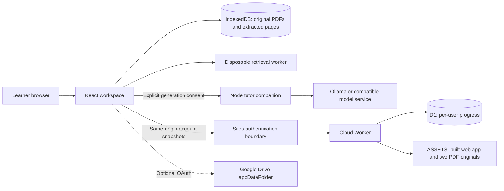
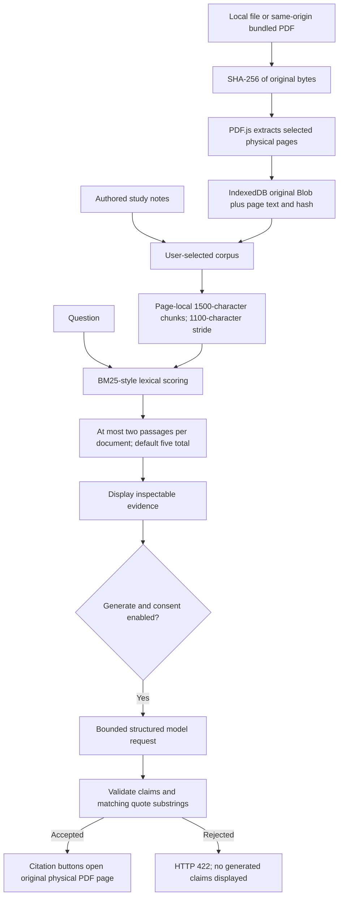

# Research tutor and account architecture

Implementation record: 2026-11-06. Sources are the checked-in modules named below. Hosted account save/load, cross-tab persistence and stale-write rejection were verified in the signed-in deployed app (see RESEARCH_QA.md); Llama is not installed in the development environment. Passing mock-provider tests does not establish real-model inference quality or availability.

## System boundaries



`TutorWorkspace.tsx` separates evidence retrieval, generated explanation, local source management and connection readiness. Evidence mode works without a model. The cloud Worker serves the app and account API; it does **not** host the Node tutor or a model. A phone needs a separately reachable HTTPS tutor endpoint. Native desktop and Android packaging remain deferred until browser approval.

## Ingestion and retrieval-generation pipeline



`ingestion.ts` accepts PDF/TXT/MD/CSV up to 35,000,000 bytes. SHA-256 binds identity to bytes, with `doc-` plus the first 24 hash characters as document ID; the full checksum is retained. PDF.js preserves one-based **physical PDF page numbers**, which may differ from printed labels. Default import indexes pages 1–100; a selected range may contain at most 500 pages. The original complete PDF Blob and `totalPages` remain available even when only a range is indexed. Reimporting identical bytes merges page numbers into the same local document. Changed bytes create a different identity.

PDF extraction is capped at 12 million characters per import; text files at 1.2 million. Fewer than 20 usable characters is rejected; scanned pages require external OCR. The UI permits 16 distinct imported documents. Ingestion reports page progress but currently has no user cancellation or aggregate storage budget. IndexedDB `dataforge-evidence` version 1 stores documents in the `documents` object store keyed by `id`; browser quota and eviction still apply.

`retrieval.ts` chunks each page separately with character offsets `start`/`end` into extracted page text, never PDF byte offsets. It tokenizes lowercase ASCII words/numbers/underscores, removes short terms and a small English stop list, and ranks title plus text using BM25-style term frequency and length normalization. Positive-score results are deterministically ordered and capped at two per document. There are no embeddings, vector database, semantic reranker or persistent search index. Non-English queries and paraphrases without lexical overlap can miss relevant passages.

`search.ts` starts a disposable module worker per request, excludes PDF binary data from its message, terminates on cancellation, and fails after 20 seconds. Every search rebuilds chunks and term statistics in memory. Client cancellation also aborts the generation fetch; the companion's provider request is bounded by its own 120-second deadline rather than a client-disconnect cancellation hook.

`SourceProof.tsx` displays title, physical page, checksum prefix, exact quoted text and full retrieved excerpt/chunk ID. It renders the original retained PDF page with PDF.js and offers original/publisher links. Older records without a PDF Blob need reimport for page rendering. The UI retains full checksum and character ranges in evidence, while the server response returns source number/document ID/page; full provenance comes from mapping that source number back to the request evidence.

## Grounding contract and trust

Evidence is explicitly framed as untrusted quoted data in `server/rag/contract.mjs`. The model is instructed to answer only from excerpts, cite every factual claim, abstain with empty claims when unsupported, and treat practice as a proposed exercise. The tutor executes no tools or SQL.

The requested JSON schema disallows additional properties. Both providers receive the schema: Ollama `format`, or compatible `/chat/completions` `response_format.json_schema` with `strict:true`. Server validation separately parses JSON and checks bounded claim/citation fields. It reconstructs accepted fields; it is not a general JSON Schema validator that rejects every extra property.

For each citation, the server checks a valid source index and a 20–280-character quote whose whitespace-normalized text appears in that excerpt. It derives page/document identity from the selected evidence, ignoring model-invented page metadata. Claims require 1–4 citations; up to ten claims are accepted. `quotes-verified` means matching quote text exists. It does **not** prove semantic entailment, completeness, publisher authenticity, PDF-to-text fidelity, currentness or correct application to a database version. Human inspection of the original page remains necessary. The server trusts client-supplied evidence; it does not independently reopen the PDF or recompute its hash.

## Tutor API

| Route / contract | Behavior |
| --- | --- |
| `GET /health` | Provider, configured model, `ready`, reason, active slot and request totals; probes model inventory with a 4-second provider timeout. |
| `POST /api/tutor` | `{question,evidence}`: question 1–4000 characters; 1–6 excerpts, text 1–2200 characters, title up to 500; optional positive integer page. |
| Successful answer | `claims:[{text,citations:[{source,quote,page,documentId,quoteVerified}]}]`, `limitations`, `practice`, `validation`, flattened `answer`, model, request ID and timing trace. |
| Rejections | `400` invalid input; `401` token; `403` disallowed supplied Origin; `413` body above 64 KB; `429` busy; `422 citation-validation-failed`; `503` no provider base; `502` provider/deadline failure. |

The companion defaults to loopback `127.0.0.1:8787`, one active generation per process, no queue, temperature zero and at most 1800 output tokens. Model response text above 30,000 characters is rejected. Request-body read deadline is 15 seconds, headers 10 seconds, Node request timeout 20 seconds; these complement the provider's 120-second generation deadline. Browser generation timeout is 125 seconds. An absent Origin is allowed; a supplied Origin must match `APP_ORIGIN`. Non-loopback binding requires `TUTOR_ACCESS_TOKEN`; public hosting still requires an authenticated HTTPS boundary. Provider keys stay server-side, and the UI service token stays in session memory. Logs contain request ID, route, status and duration, without raw questions, evidence, prompts or answers.

## Authenticated account synchronization

```mermaid
sequenceDiagram
  participant Browser
  participant Sites as Sites trusted authentication
  participant Worker
  participant DB as D1
  Browser->>Sites: GET /api/progress with same-origin credentials
  Sites->>Worker: Inject trusted oai-authenticated-user-id
  Worker->>DB: SELECT by user_id
  DB-->>Browser: revision and snapshot (or revision 0, null)
  Browser->>Browser: Explicit merge / use account / keep device review
  Browser->>Sites: POST revision plus progress; same-origin JSON
  Sites->>Worker: Authenticated user header
  Worker->>DB: INSERT or UPDATE WHERE revision matches
  alt Expected revision matches
    DB-->>Browser: New revision and updatedAt
  else Another device saved
    Worker-->>Browser: 409 revision-conflict; reload and review
  end
```

`worker/cloud.ts` relies on the Sites boundary to supply and protect `oai-authenticated-user-id`. Clients never choose a user ID in the JSON body. Direct public access that allows a caller to spoof this header would break account isolation; do not expose an equivalent unauthenticated Worker route. GET and POST require identity; POST additionally requires an exactly matching Origin, JSON content type and a UTF-8 body of at most 2,000,000 bytes (declared and actual size checks). Responses are `no-store`, `Vary: Cookie`, and `nosniff`.

`GET /api/progress` returns `{revision:0,progress:null}` for a new account, otherwise `{revision,progress,updatedAt}`. `POST` accepts `{revision:nonnegativeInteger,progress:Progress}` and returns `{revision,updatedAt}`. Failures: `400` invalid snapshot, `401` signed out, `403` origin, `405` method, `409` stale revision, `413` size, `415` content type, `503` unavailable storage. Unknown `/api/*` routes return JSON 404.

`db/schema.ts` and `drizzle/0000_account_progress.sql` define `user_progress(user_id TEXT PRIMARY KEY, revision INTEGER NOT NULL, payload TEXT NOT NULL, updated_at TEXT NOT NULL)`. The validated version-1 progress JSON holds name, goal, attempts, review schedules, bookmarks, project/resource checklist state, notes and SQL drafts. First save uses insert-on-conflict-do-nothing; later writes increment revision atomically only when the expected revision matches. There is one current snapshot per account, with no server history, deletion endpoint or scheduled backup supplied by this code.

`AccountSync.tsx` fetches a snapshot on opening the sync screen but never automatically applies or saves it. Explicit review precedes saving: merge unions attempts by ID and saved lists; this device wins conflicting notes, drafts, reviews and scalar settings. A 409 disables saving until reload. PDF bytes, extracted pages and the search corpus stay on each device and are absent from both account and Drive snapshots. Google Drive remains a separate optional integration requiring a configured OAuth web client, Drive API and `drive.appdata` consent; its snapshots are append-only, without account API revision semantics.

## Capacity, deployment and integration limits

The six-reference catalog is metadata, not six indexed books. Only PostgreSQL 18 (15,864,875 bytes) and Computer Networks open 6.1 (22,254,526 bytes) are bundled unchanged with manifest hashes and license attribution. Database Design and the Bash/Make/GAWK downloads were unavailable during acquisition and remain external links requiring upload. Preserve source notices, the PostgreSQL license and SystemsApproach attribution; consult `public/pdfs/ATTRIBUTION.txt` and `docs/PDF_SOURCES.md`.

The build migrates static hosting to a Worker plus `ASSETS` and D1 `DB`; `.openai/hosting.json` preserves the existing private project ID and removes static mode. Vite outputs `dist/client`; `build-cloud.mjs` bundles `dist/server/index.js`, copies migrations and writes a Wrangler configuration. Its database UUID is a provisioning placeholder, not evidence of a provisioned production database. Offline precache excludes PDF files; imported originals persist independently in IndexedDB. Account sync and model generation need network access. No cross-device PDF replication, background sync, OCR, automatic source refresh, model hosting, hostile-code sandbox or native package is provided. Operational verification and recovery are in [RAG_OPERATIONS.md](RAG_OPERATIONS.md).
